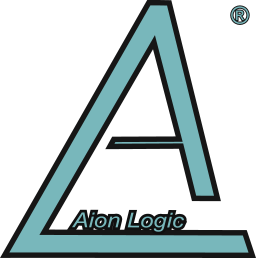

  

<h1 align="center">Aion Logic® for Home Assistant</h1>

  <em>The intelligent connection between your climate, security, and daily routines.</em>

  <a href="#nederlands">Nederlands</a> · <a href="#english">English</a>

---

## Nederlands

### Welkom bij Aion Logic

Aion Logic is een premium, cloudgedreven AI-systeem voor Home Assistant, ontwikkeld door **Core Automations**.

Deze repository bevat uitsluitend de **Edge Client** (de ‘zintuigen’ en ‘handen’). Om de veiligheid en privacy te waarborgen, bevindt alle intelligente logica — waaronder de **Active Guardian** (beveiliging) en de **Neural Core** (zelflerende algoritmes) — zich in de beveiligde Aion Cloud-omgeving.

> ⚠️ **Licentie vereist:** Voor het activeren van deze integratie is een geldige Aion Logic-licentiesleutel vereist.

### Ontdek Aion Logic

Bezoek onze website voor:

- **Pakketoverzicht:** Vergelijk de Comfort-, Guardian- en Neural-pakketten.
- **Licentiebeheer:** Vraag uw activatiecode aan.
- **Officiële onboarding:** Volg na aankoop de beveiligde stapsgewijze installatie.

---

## English

### Welcome to Aion Logic

Aion Logic is a premium, cloud-powered AI system for Home Assistant, developed by **Core Automations**.

This repository contains only the **Edge Client** (the system’s “senses” and “hands”). To help protect security and privacy, all intelligent logic — including the **Active Guardian** (security) and the **Neural Core** (self-learning algorithms) — runs in the secure Aion Cloud environment.

> ⚠️ **A license is required:** A valid Aion Logic license key is required to activate this integration.

### Discover Aion Logic

Visit our website to:

- **Explore plans:** Compare the Comfort, Guardian, and Neural plans.
- **Manage your license:** Request your activation code.
- **Get started:** Follow the secure, step-by-step onboarding process after purchase.

---

  <small>Voor ondersteuning en commerciële aanvragen verwijzen wij u uitsluitend naar onze officiële kanalen. For support and commercial enquiries, please use our official channels. Developed by <b>Core Automations™</b> &copy; 2026</small>

